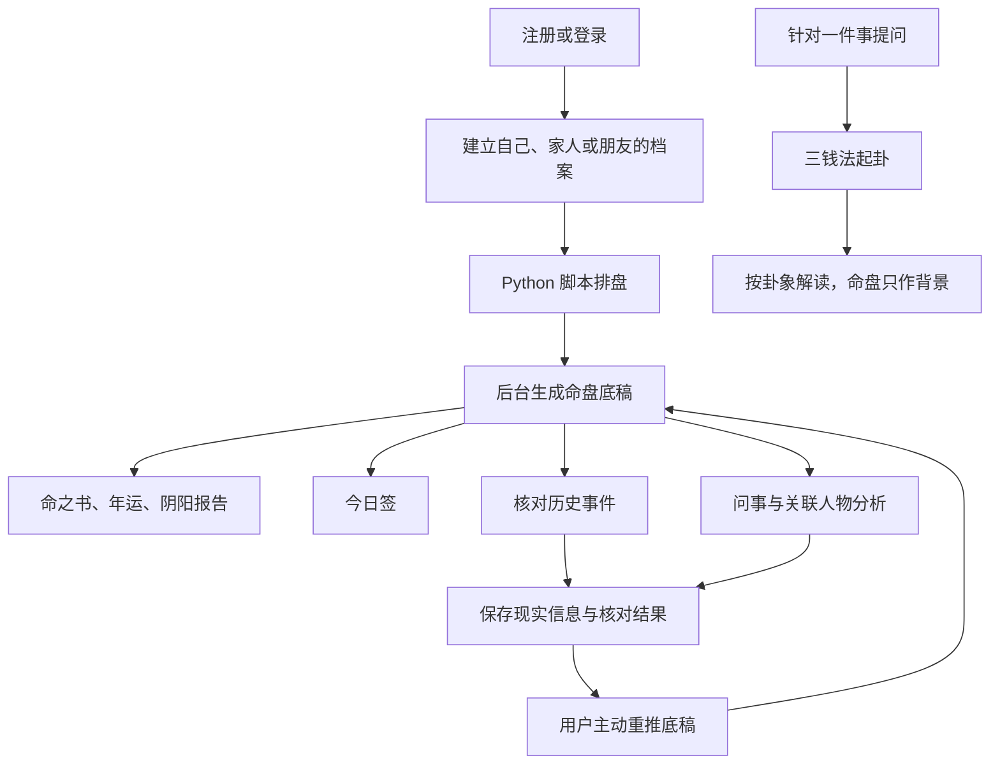
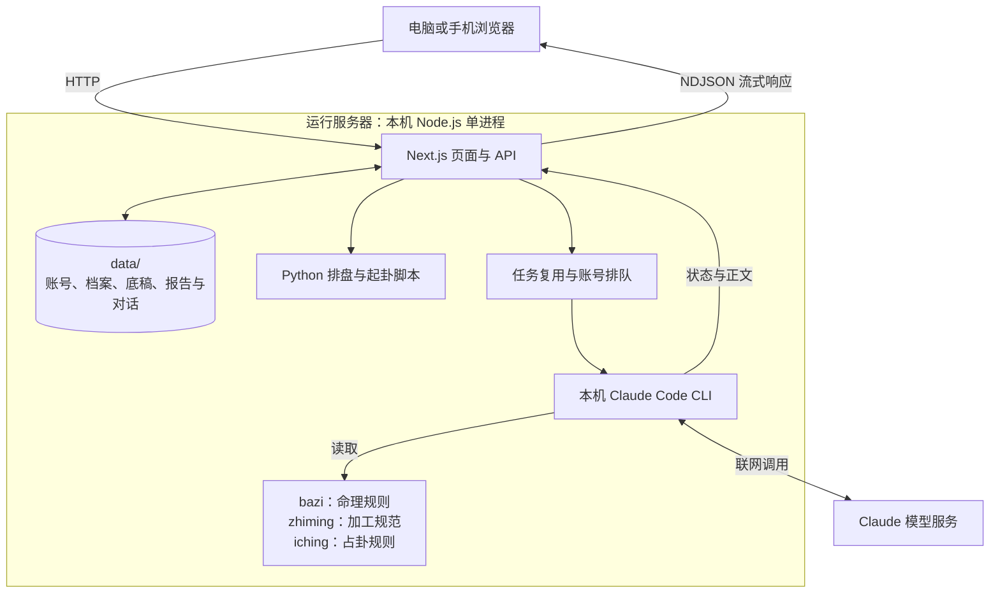

# 知命 · Zhiming

把命理分析从终端带到手机：一次建档，持续复用命盘，通过报告、今日签、问事与占卦提供不同场景的解读。

**当前定位：本地运行、支持局域网访问的 H5 产品原型，面向内部演示与小范围体验。** 页面与 API 由 Next.js 提供，排盘由 Python 脚本完成，解读由服务器上的 Claude Code 调用模型生成。当前没有独立云端后端，也没有内置支付流程。

## 产品背景

项目从「同一个人的出生信息只输入一次，后续分析直接引用」出发，把原本在 Claude Code 中完成的命理工作流变成普通人可操作的产品。它主要解决三个问题：

| 问题 | 产品做法 | 对用户的价值 |
| --- | --- | --- |
| 每次问事都要重复提供出生信息与经历 | 按人保存档案、现实信息和历史事件核对结果 | 一次建档，后续持续复用 |
| 多次解读容易出现相互矛盾的结论 | 先生成一份命盘底稿，报告与问事围绕底稿展开 | 不同入口共享同一套分析依据 |
| 终端输出篇幅长、专业术语多 | 按章节组织内容，以卡片、对话和大白话呈现 | 按当前目标阅读，减少理解成本 |

功能形态参考 FateTell，但不复用其品牌与图片素材。产品的验收目标是：**同一个人、同一个问题，在日常 Claude Code 和产品中的核心结论一致，差异只在表达与呈现。**

## 产品入口

| 入口 | 能做什么 |
| --- | --- |
| 今日 | 查看当天干支、自己的命盘与今日签；日签按档案和日期缓存 |
| 报告 | 阅读「命之书」10 章、「年运报告」6 章、「阴阳报告」2 章，按需生成 |
| 问事 | 围绕具体问题对话，可关联其他人物的命盘；从提问中提取用户明确提供的现实信息 |
| 占卦 | 针对一件事，以三钱法起卦并解读，保留占卦记录 |
| 档案 | 管理自己、家人和朋友的出生信息；查看命盘、底稿、备注与历史事件校准 |

档案支持阳历、农历、闰月、时辰未知、出生地、曾用名、改名年份及已故年份。每个账号最多有一个「自己」档案，可添加其他人物。

## 核心逻辑

### 从档案到持续解读



- **排盘先于解读。** 服务端调用 `bazi/scripts/pai_pan.py`，把输出解析为四柱、大运、神煞等结构化结果；不让模型重新口算排盘。
- **底稿是共同依据。** 建档后后台生成完整底稿；报告、日签和问事在需要时等待或复用它。
- **校准由用户触发更新。** 现实信息与核对结果先保存为备注，用户主动「重推底稿」后参与重新分析。重推会清空该档案的旧报告章节与日签，后续按需重建。
- **占卦有独立依据。** 卦象与断卦取用以 `iching/scripts/qigua.py` 为准；已有命盘只作为解读背景，不改变卦象。

排盘与「今天」的日期统一按北京时间 UTC+8 处理，不随服务器所在时区切换。

### 系统如何分工



这里的「本机」是**运行服务的电脑**。手机只需要浏览器，不需要安装 Node.js、Python 或 Claude Code。

| 层 | 责任 | 位置 |
| --- | --- | --- |
| 产品层 | 页面、账号、档案、存储、缓存、流式反馈与任务排队 | `app/`、`components/`、`lib/` |
| bazi skill | 排盘脚本、命理规则、典籍参考与底稿推演依据 | 默认 `~/.claude/skills/bazi`，不随本仓库分发 |
| zhiming skill | 底稿结构、章节规范、日签、问事及相关派生规则；结论遵循 bazi 底稿 | [skills/zhiming/](skills/zhiming/) |
| iching skill | 起卦脚本、卦象与变占取用规则、占卦解读规范 | [skills/iching/](skills/iching/) |

产品代码中的 prompt 只负责指定 skill、模块与输入数据，命理及内容规则统一放在对应 skill 中。产品调用 Claude Code 时只开放 `Skill,Read` 工具，并限定参考资料读取范围，不加载用户级 hooks 与插件。

### 缓存、排队与恢复边界

| 场景 | 当前行为 |
| --- | --- |
| 同一章已有结果 | 直接读取本地缓存，不重复调用模型 |
| 同一份内容同时被请求 | 复用同一个生成任务 |
| 同一账号发起多个推算 | 串行执行；服务实例默认最多同时运行 3 个 Claude 任务 |
| 用户离开页面 | 服务端继续生成，完成后保存；返回页面可接上正在进行的任务 |
| 单次模型调用超过 10 分钟 | 服务端结束该 Claude 进程并返回生成失败，需重试 |
| 服务进程重启 | 已保存结果保留；内存队列与任务状态不会自动恢复 |
| 修改 skill 或 prompt | 已生成缓存不会自动更新，需要在产品中重推对应内容 |

## 环境要求

以下是当前项目的依赖及本机已验证版本，不代表其他版本均不可用。

| 依赖 | 要求或已验证版本 | 用途 |
| --- | --- | --- |
| 操作系统 | macOS 已验证；需支持子进程、可写目录与符号链接 | 本地服务、Python 与 Claude CLI 调用；其他系统尚未验收 |
| Node.js | 已验证 `25.6.0`；自检需要能直接加载 TypeScript 文件的 Node 版本 | Next.js 与自检脚本 |
| pnpm | `10.32.1`，与 `package.json#packageManager` 一致 | 按锁文件安装与运行 |
| Python | 已验证 `3.9.6`，命令名为 `python3` | 排盘与起卦；当前脚本只使用标准库，无需 `pip install` |
| Claude Code | 已验证 `2.1.288`；`claude` 命令可用且已认证 | headless 模式下读取 skills、生成解读 |
| Claude 账号 | 具有所选模型的使用权限与可用额度 | 生成解读；额度及费用遵循账号自身方案 |
| bazi skill | 维护者当前使用的本地改版，包含脚本和参考文件 | 必须单独准备，克隆仓库不会自动获得 |
| 网络 | 安装依赖时能访问包源，生成内容时能连接 Claude 模型服务 | 本地存储不等于离线推理 |

注意：`Node.js 22.17.1` 在本机执行 `pnpm check` 时会报 `Unknown file extension ".ts"`。遇到同样问题，请切换到上述已验证版本后再检查，避免把运行时版本问题误判为排盘错误。

## 启动方式

以下命令都在**本仓库根目录**执行。GitHub 仓库根目录就是原本本地 `bazi/app/` 的内容，克隆后不需要再进入另一个 `app/` 才运行命令。

### 1. 克隆并安装依赖

```bash
git clone git@github.com:ZhiwenDeng-dev/zhiming.git
cd zhiming

# 已有对应版本 pnpm 时跳过这一行
npm install --global pnpm@10.32.1
pnpm install --frozen-lockfile
```

这是私有仓库，克隆前需要具备仓库权限，并配置好 GitHub SSH 认证。

### 2. 准备 bazi skill

从维护者取得与当前产品配套的 bazi 本地改版，放到以下默认位置：

```text
~/.claude/skills/bazi/
├── SKILL.md
├── scripts/
│   └── pai_pan.py
└── references/
    ├── classical-texts.md
    ├── wuxing-tables.md
    ├── dayun-rules.md
    ├── shensha-table.md
    └── shichen-table.md
```

这套 skill 源自 `jinchenma94/bazi-skill`，但当前依赖包含本地修改，不能假定上游原版与产品契约兼容。应整套迁移，包含其他随附文件，以上仅列关键文件；无需改写它的规则。使用其他位置时，配置 `BAZI_SKILL_DIR`，见下方环境变量。

`zhiming` 与 `iching` 已在仓库内。首次生成时，程序会自动在 `claude-workspace/.claude/skills/` 中建立三个 skill 的符号链接。

### 3. 确认 Claude Code 已认证

如果服务器尚未安装 Claude Code，先按 [Claude Code 官方安装说明](https://code.claude.com/docs/en/setup)完成安装，再检查：

```bash
node --version
pnpm --version
python3 --version
claude --version
claude auth status
```

未登录时执行：

```bash
claude auth login
```

随后再次执行 `claude auth status` 确认状态。登录的是服务器上的 Claude Code，和产品内自行注册的账号是两套独立身份。

### 4. 运行自检

```bash
pnpm check
```

预期输出 `selfcheck ok`。自检覆盖排盘解析、时辰未知、64 卦映射、校准文本解析，以及产品与 skills 的章节和备注格式契约；不会调用 Claude 模型，也不能代替模型连接与权限验证。

### 5. 选择运行模式

同一份 `data/` **只能运行一个服务进程**，不要同时开启 `dev` 和 `start`，也不要为了换端口启动第二个实例。切换模式前，先等当前推算结束，再停止原进程。

| 场景 | 命令 | 访问方式 |
| --- | --- | --- |
| 电脑开发与调试 | `pnpm dev` | [http://localhost:3000](http://localhost:3000) |
| 内部演示、手机体验 | `pnpm serve` | 先构建，再监听 `0.0.0.0:3000`；本机与同局域网设备可访问 |
| 只构建 | `pnpm build` | 生成 `.next/`，不启动服务 |
| 启动已有构建 | `pnpm start -H 0.0.0.0 -p 3000` | 必须先完成构建；代码更新后重新构建 |

手机与服务器连接同一 Wi-Fi 后，访问 `http://<服务器局域网IP>:3000`。可在系统网络设置查看 IP；macOS 常见 Wi-Fi 网卡可用 `ipconfig getifaddr en0` 查询。手机不能使用 `localhost` 访问电脑。

演示使用 `pnpm serve`，以避免开发模式下跨源资源限制。上述命令以前台方式运行，演示期间保持终端和服务器开启。

### 6. 首次体验

1. 打开页面，创建产品账号。
2. 建立一个「自己」档案，录入出生信息。
3. 查看命盘，等待后台底稿生成；界面提示首次约 2–3 分钟，实际取决于模型与网络。
4. 进入报告按章阅读，再体验今日签、问事或占卦。
5. 在档案中补充现实信息、核对历史事件；需要更新分析依据时主动重推底稿。

<details>
<summary>macOS：需要脱离终端常驻演示时</summary>

先在前台完成 `pnpm build`。确认构建成功、原服务已停止且没有进行中的推算后，再启动：

```bash
mkdir -p logs
nohup pnpm start -H 0.0.0.0 -p 3000 > logs/server.log 2>&1 < /dev/null &
```

查看运行日志：

```bash
tail -f logs/server.log
```

使用 `lsof -nP -iTCP:3000 -sTCP:LISTEN` 查找实际服务 PID。如需按项目现有方式阻止 Mac 在接电时自动休眠，运行 `caffeinate -s -w <服务PID>`，将占位符替换为查询到的 PID。服务不会因此获得开机自启能力。

</details>

## 环境变量

默认路径与模型可用时，无需创建环境文件。需要覆盖时，在仓库根目录创建不提交 Git 的 `.env.local`：

```dotenv
CLAUDE_MODEL=claude-opus-5-5
CLAUDE_CONCURRENCY=3

# 只有自定义路径时才取消注释并替换占位路径
# BAZI_SKILL_DIR=/absolute/path/to/bazi
# CLAUDE_BIN=/absolute/path/to/claude
```

| 变量 | 默认值 | 说明 |
| --- | --- | --- |
| `BAZI_SKILL_DIR` | `~/.claude/skills/bazi`，由代码展开为用户主目录 | 自定义时使用绝对路径，目录内须有 `SKILL.md`、`scripts/` 与 `references/` |
| `CLAUDE_BIN` | `claude` | 从服务进程的 `PATH` 查找；常驻进程找不到命令时可指定可执行文件绝对路径 |
| `CLAUDE_MODEL` | `claude-opus-5-5` | 这是代码当前默认值，需确认账号有访问权限；也可设为 CLI 支持的其他模型，如 `sonnet` |
| `CLAUDE_CONCURRENCY` | `3` | 单实例允许同时运行的 Claude 任务数，配置为正整数；同账号仍串行执行 |

`.env.local` 由 Next.js 加载，修改后需重启服务。`pnpm check` 和 `scripts/parity.sh` 是独立脚本，不自动加载该文件；使用自定义 skill 路径时，先在终端 `export BAZI_SKILL_DIR=/absolute/path/to/bazi`，再执行它们。

## 数据与运行边界

### 数据存在哪里

```text
data/
├── usernames.json                      # 昵称到账号 ID 的索引
├── sessions.json                       # 登录会话
└── users/<uid>/
    ├── user.json                       # 账号信息，密码以 scrypt 派生值存储
    ├── profiles/<pid>.json              # 出生信息与结构化排盘
    ├── readings/<pid>/
    │   ├── analysis/base.md            # 命盘底稿
    │   ├── daily/<date>.md             # 每日签
    │   └── <kind>/<chapter>.md          # 报告章节
    ├── notes/<pid>.json                # 现实信息与历史事件核对结果
    ├── chats/<pid>.json                # 问事对话
    └── divinations.json                # 占卦记录
```

账号按目录隔离，服务端根据登录会话访问对应数据。`data/`、`logs/`、`claude-workspace/` 和 `.env*` 均已忽略，不会随代码推送到 GitHub。仓库外原有 `people/`、`pairs/`、`business/` 资料库与产品数据互不读写。

**本地保存不等于数据不出本机。** 生成解读时，相关出生信息、排盘、底稿、备注或对话上下文会随 prompt 发给 Claude 使用的模型服务；这些数据不因 Git 忽略规则而免于模型调用。

GitHub 只保存代码，不是产品数据备份。迁移或备份需要另行保存完整 `data/`，并同步准备相同版本的外部 bazi skill；复制数据前先停止服务，避免复制到写入中的状态。

### 适用范围

| 当前适用 | 尚未实现 |
| --- | --- |
| 单机运行、局域网演示、小范围体验 | 面向公网的正式生产服务 |
| 单进程内文件写入串行化、内存任务排队 | 多实例共享数据、持久化队列和重启恢复 |
| 本机 Claude Code 与文件存储 | 独立模型 API 接入、数据库与后台 worker |

面向公网或多人持续使用，需要另行设计数据库、模型凭据、持久化队列、访问控制与运维方式。当前实现不能直接当作 Serverless 或多实例应用部署。

## 代码导航与检查

| 位置 | 内容 |
| --- | --- |
| `app/(main)/` | 五个主入口，以及命盘、底稿、报告章节页面 |
| `app/login/`、`app/api/auth/` | 产品注册、登录与会话 |
| `app/api/` | 档案、报告、日签、问事、占卦、备注与任务接口 |
| `components/` | UI、档案切换、流式读取、全局任务提示 |
| `lib/paipan.ts`、`lib/iching.ts` | 排盘脚本适配、卦象呈现 |
| `lib/claude.ts`、`lib/analysis.ts` | Claude CLI、任务复用与排队、底稿生成 |
| `lib/prompts.ts`、`lib/reports.ts` | 数据拼装与模块选择、报告章节目录 |
| `lib/store.ts`、`lib/auth.ts`、`lib/notes.ts` | 本地存储、认证、现实信息 |
| `skills/` | 随仓库维护的 zhiming 与 iching skills |
| `scripts/selfcheck.mjs` | 不调用模型的自检 |
| `scripts/parity.sh` | 产品与日常 Claude Code 的底稿一致性比对 |

常用检查：

```bash
pnpm check
pnpm lint
pnpm exec tsc --noEmit
pnpm build
```

一致性比对会真实调用模型并消耗额度，且当前脚本假定仓库父目录是日常使用的 bazi 工作区、`claude-workspace/` 已初始化；它不是新克隆后的必跑步骤。更多开发约定见 [CLAUDE.md](CLAUDE.md) 与 [AGENTS.md](AGENTS.md)。

## 常见问题

| 现象 | 检查与处理 |
| --- | --- |
| 页面可打开，但 AI 内容生成失败 | 执行 `claude auth status`，检查网络、额度与所选模型权限；未认证时执行 `claude auth login` |
| 提示找不到 bazi skill，或排盘脚本不存在 | 检查完整 skill 目录与 `BAZI_SKILL_DIR`；新机器需要单独取得配套版本 |
| 提示找不到 `python3` 或 `claude` | 检查运行服务时的 `PATH`；Claude 可用 `CLAUDE_BIN` 指定绝对路径 |
| `pnpm check` 报 `.ts` 扩展名错误 | 检查 `node --version`，切换到已验证的 Node.js 版本 |
| 手机无法打开或资源加载失败 | 使用 `pnpm serve`，确认手机与服务器同一局域网、IP 正确，且防火墙允许 3000 端口 |
| 端口 3000 被占用 | 先确认是否已有本项目服务；复用或停止原进程，不要对同一数据目录再开一个实例 |
| 报告一直显示排队中 | 查看全局任务状态；同账号一次只执行一个推算，其他任务需等待 |
| 修改规范后仍显示旧报告 | 结果已缓存，在产品中重推对应内容；重推底稿会清空旧报告与日签 |
| 新机器看不到原账号与报告 | 运行数据不在 Git 中，需从原服务器迁移 `data/`；已保存结果与代码独立 |

命理与占卦内容仅供参考；产品目标是帮助用户理解与整理问题，最终选择由用户自己作出。
